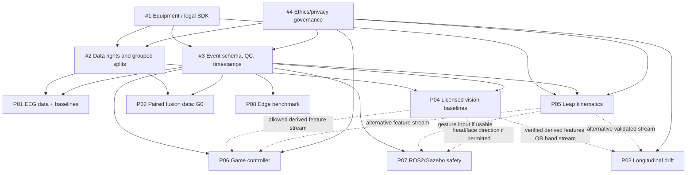

# Research dependencies, critical path and resource limits
Version 1.0.0 · 2026-10-29

## DAG: foundational gates and application reuse

The graph indicates component dependencies, **not** a requirement to complete or publish another paper. P03 may proceed with a standalone verified webcam/Leap input; P06 must not be blocked by an unfinished P03–P05 manuscript. P07 simulation with scripted commands can begin without real Leap data.

## Paper-specific go/no-go conditions

| Track | Critical entry gate | Independent fallback |
|---|---|---|
| P01 | Original EEG dataset legally usable with documented channel reference and labels | A different licenced EEG benchmark; avoid Muse-equivalence claims |
| P02 | Truly paired, synchronized modalities + time-aligned target labels | Change public corpus; stop M0 if none exists |
| P03 | Approved repeated-session N=1 protocol and valid local feature source | Webcam/Leap alone; no Muse dependency |
| P04 | Rights to facial annotated evaluation set and local frame retention policy | Alternative licensed facial benchmark |
| P05 | Exact Leap hardware generation and SDK + approved N=1 protocol | Webcam hand landmark engineering pilot, requiring scope revision |
| P06 | Instrumented game plus one verified feature stream | Offline synthetic policy safety followed by N-of-1 |
| P07 | Launchable ROS 2/Gazebo simulation and independent stop/go governor | Scripted teleoperation intent; no physical-robot tests |
| P08 | Physically measured real-node latency and validated trace timestamps | CPU-only existing node; no need for new hardware |

## Shared integration contracts

1. All sensors and public data pass the same provenance/clock/quality event contract in #3; avoid collecting raw Tobii 5 research eye-gaze streams or gated Muse signals.
2. Public data may contain many subjects but require licensing and grouping by person/session; local prospective studies remain N<=3 adult staff, preference N=1.
3. The interface between applications and models passes `prediction, uncertainty, quality, missingness, timestamp, version`. A model is allowed to abstain.
4. Game feedback policies include bounded rate and fixed-mode fallback; robot control **always** passes the independent deterministic safety supervisor.
5. No metered GitHub-hosted Actions, cloud data products or paid SDKs.
